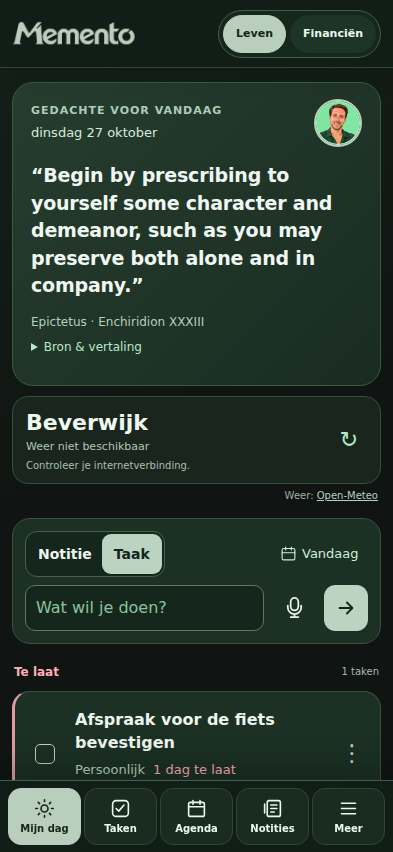
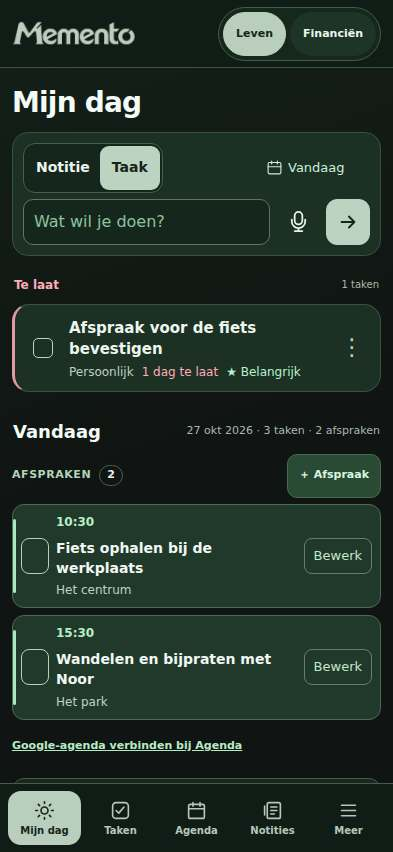
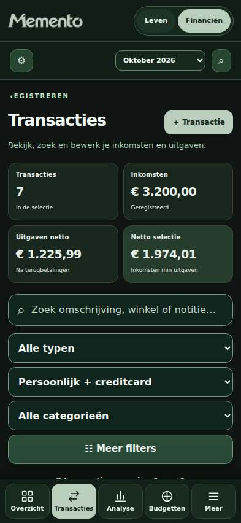
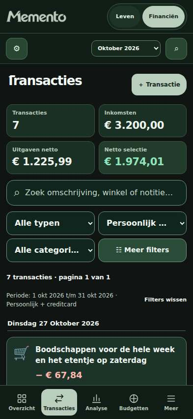
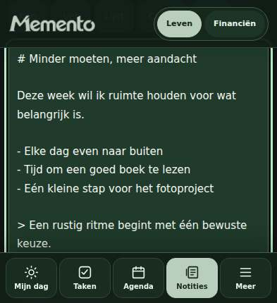
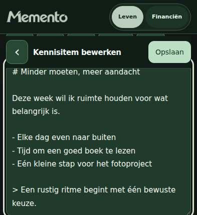

# Memento — mobiele verfijning

Dit is een visuele en ergonomische wijziging op `design/memento-mobile-refinement`, vanaf `main` op `f77a8d20b65def564dd86a1ab59592c34b4ab889`. Er is niets naar `main` gemerged of op de productiesite gepubliceerd.

Alle nieuwe screenshots bevatten uitsluitend fictieve testgegevens uit `tests/helpers/visual-fixture.cjs`, in een lege lokale browsercontext op de GitHub Actions-runner. Er is geen verbinding met de persoonlijke Memento-opslag. Externe HTTPS-verzoeken zijn tijdens de browserproeven geblokkeerd.

## Schermen en keuzes

| Onderdeel | Aangetroffen gebruiksprobleem | Wijziging |
| --- | --- | --- |
| Mijn dag | Quote en weer namen het eerste scherm in; afspraken stonden veel lager. | Bestaande taken, afspraken en snelle invoer komen eerst. Inspiratie en weer blijven verderop beschikbaar. |
| Financieel overzicht | Herhaalde toelichting, een grote inkomstenkaart en zware decoratie verdrongen rekeningstanden. | Compacte inkomsten/uitgaven naast elkaar, netto eronder, minder herhaling en rustiger kaartvormen. Bedragen en rekenregels zijn identiek. |
| Transacties | Samenvatting en vier gestapelde filters vulden het mobiele scherm. | Twee kolommen voor filters en samenvatting, minder dubbele uitleg, lange omschrijvingen blijven afbreken. De eerste lange titel krijgt ruimte boven de onderbalk. |
| Taken | Kop en primaire actie stonden los van elkaar; kleine menu- en titelknoppen. | Kop en toevoegen naast elkaar, rustiger taakrijen, titel/afvinken/opties met ruime aanraakvlakken. |
| Boodschappen / wensen | Kleine actieknoppen, vooral op 360 px, en wisselende kaartstijlen. | Acties van minimaal 44 px in de gecontroleerde boodschappenrijen; consistente knoppen, typografie en afgeronde oppervlakken. |
| Agenda | Maandbediening kon tegen de schermrand lopen; zeven dagkolommen hadden kleine doelen. | Maand en bediening op afzonderlijke regels, dagcellen minimaal 44 px hoog/breed op de geteste mobiele breedtes. |
| Kenniscentrum | Dubbele kop, hoge verzamelingkaarten en weinig ruimte voor inhoud. | Eén kop, compactere verzamelingen en lijsten, grotere leestekst; bestaande recepten, checklist en bijlageweergave behouden. |
| Notitie-editor | Opslaan stond onder een lang formulier; te weinig bruikbare ruimte bij een korte viewport. | Dezelfde opslaanactie staat in een vaste editorheader. Type/verzameling delen een regel, de inhoud krijgt meer ruimte. Tijdelijk geen onderbalk bij een kort scherm met actieve tekstinvoer. |
| Fitness | Grote tussenruimtes, de rusttimer kon achter de bovenbalk schuiven; lange dialogen. | Compactere sessie- en setweergave, timer onder de bovenbalk, scrollende dialooginhoud met vaste acties. Bestaande sets en trainingslogica blijven behouden. |
| Instellingen | Back-upknoppen liepen buiten de financiële kaart, ook op desktop; herstelvinkje stond onduidelijk. | Knoppen lopen binnen de kaart door, duidelijker checkboxuitlijning, leesbaardere toelichting en herkenbare destructieve knoppen. |
| Financiële en Leven-dialogen | Opslaan en annuleren verdwenen onder lange formulieren. | Afzonderlijk scrollvlak, vaste kop/acties; financiële dialoog ondersteunt Escape, focus terug naar de opener en een Tab-cyclus. |
| Opslagmelding | Na de compactere indeling kon de bestaande waarschuwing een actie afdekken. | De presentatielaag reserveert de gemeten hoogte. De opslagguard, waarschuwingstekst, weigering, sluiten en herladen blijven ongewijzigd. |

De bestaande hoofdnavigatie, labels en routes zijn behouden. De groene identiteit, het logo en `Reflect · Refine · Conquer` zijn behouden. Het dynamische PIN-bos en alle PIN-logica zijn ongemoeid gelaten. Er zijn geen nieuwe productfuncties, externe diensten of frontendafhankelijkheden toegevoegd.

## CSS-opruiming

Er zijn 1.134 eerdere componentregels verwijderd waarvan **alle** eigenschappen door een latere regel met dezelfde selector en dezelfde media-/supportsvoorwaarden werden overschreven, met gelijke of sterkere `!important`-prioriteit. PIN-, `:root`-, `html`- en ongescopeerde `body`-regels zijn van deze opschoning uitgesloten. Vervolgens zijn 31 afzonderlijke, volledig overschreven declaraties in aangepaste capture-, navigatie-, kop- en boodschappencomponenten verwijderd.

De transactiesamenvatting heeft nu één complete eigenaar in `assets/memento-ui.css`; de verspreide eerdere samenvattingsregels zijn verwijderd. De bestaande mobiele transactiefilterregel is direct gecorrigeerd. De uitzondering die boodschappenknoppen op 360 px verkleinde naar 36 px is verwijderd. De eigen CSS-bestanden van Fitness en Kenniscentrum zijn rechtstreeks aangepast. Lege mediaregels en twee lege stijlblokken zijn verwijderd.

Inline CSS: 29 → 27 stijlblokken; circa 311.485 → 211.150 tekens. Inline `!important`: 1.015 → 791, plus 38 in de gedeelde presentatielaag. De nieuwe laag bevat gedeelde kleur-, radius- en afstandstokens. De grote resterende historische cascade is bewust niet volledig herschreven. Dit blijft onderhoudswerk voor een afzonderlijke fase.

## Bestanden en functies

- `index.html`: CSS-opruiming, uitsluitend presentatievolgorde in `renderToday()`, scrollwrapper in `showDialog()` en `showModal()`, financiële focusafhandeling in `showModal()` / `closeModal()`, verwijzingen naar gewijzigde UI-assets.
- `assets/memento-ui.css`: gedeelde tokens en aangepaste shell, navigatie, rijen, kaarten, financiële samenvatting, agenda, instellingen en dialogen.
- `assets/memento-ui.js`: zichtbare viewporthoogte, tijdelijke toetsenbordruimte, gemeten ruimte voor de bestaande opslagwaarschuwing. Geen opslagtoegang.
- `assets/memento-knowledge.css` en `assets/memento-knowledge.js`: compactere componenten, leesruimte en presentatie van `renderEditor()`; dezelfde bestaande opslaanhandler, autosave en revisies.
- `assets/memento-fitness.css`: compactere bediening en scrollende dialooginhoud. Geen wijzigingen in Fitness-JavaScript.
- `sw.js`: cache `memento-pwa-v26-20261027-design-v1`, overeenkomstige assetversies en de twee nieuwe lokale UI-assets in de offline kern. De bescherming van het historische HTML-entrypoint blijft intact.
- `tests/visual-browser.cjs`, `tests/helpers/visual-fixture.cjs`, `tests/helpers/visual-assertions.cjs`: geïsoleerde voor/na-captures en echte browserinteracties.
- `.github/workflows/visual-review.yml`: vaste uitgangsversie en dezelfde fixture voor voor/na, vier breedtes, Chromium, artifact-upload en bytevergelijking van de zichtbare PIN-screenshots.
- `docs/design-review/`: dit verslag en de screenshotvergelijking. Deze bestanden zijn niet onderdeel van de appnavigatie of de PWA-kerncache.

## Veiligheid en compatibiliteit

De bestanden voor de Web Locks-guard, IndexedDB-bijlagenopslag, Knowledge-core, Fitness-core en Fitness-controllers, ZIP-back-up, prullenbak en het PIN-bos zijn bytegelijk aan de uitgangsversie. De twee gewijzigde inline scripts hebben alleen bovenstaande presentatie-aanpassingen. Er zijn geen wijzigingen aan opslagkeys, gegevensmodellen, financiële berekeningen, migraties, back-upformaten, verwijdering of herstel.

Bestaande gegevens en ZIP-back-ups blijven compatibel; de daadwerkelijke browserproef controleert een volledige export/herstelronde en bijlage-ID’s. Oudere reeds geopende tabbladen blijven hun geladen code gebruiken totdat ze worden herladen; deze ontwerpwijziging voegt daarvoor geen veiligheidsgarantie toe. Offline apparaten zien de nieuwe vormgeving nadat de nieuwe serviceworker en assets eenmaal online zijn geïnstalleerd.

## Tests en bewijs

Gecontroleerde applicatiecode: `5af288c1e6a30fec9b89d6d2a73d6bfb5b52ec9d`. De latere documentatiecommit verandert geen applicatie- of testcode.

| Controle | Werkelijk resultaat |
| --- | --- |
| Syntax | 9 uitvoerbare inline scripts en 6 gewijzigde/nieuwe scripts syntactisch geldig. |
| Opslagveiligheid | 22/22 controles geslaagd. |
| Native Web Locks | Exclusieve schrijver en vrijgave bij beëindigen geslaagd. |
| Fitness-core | 25/25 geslaagd. |
| Kenniscentrum / ZIP | 16/16 geslaagd. |
| Prullenbak | Bestaande suite geslaagd. |
| Echte opslagbrowsertest | Geslaagd: twee tabbladen, conceptbehoud, quotafout/herproberen, stale purge, IndexedDB-bijlage, volledige ZIP-herstelronde, offline laden en historische HTML-redirect. |
| Nieuwe visuele/browserproeven | Alle vier breedtes geslaagd; 30 vóór- en 34 naschermen per breedte. Geen JavaScriptfouten of horizontale documentoverflow in de gecontroleerde naschermen. |
| Aanraakvlakken | Hoofdnavigatie, boodschappenacties en kalenderdagen expliciet ≥44 × 44 CSS-pixels gecontroleerd. |
| Formulieren | Financiële vereistenvalidatie, openen/opslaan/bewerken/zoeken/annuleren, Tab-cyclus en focusherstel geslaagd. Leven: snel toevoegen, detail, bewerken en afvinken geslaagd. Lange notitie opgeslagen vanuit korte viewport, opslaan bleef zichtbaar. |
| PWA / PIN | Nieuwe UI-assets offline geladen met actief schrijfslot. De zichtbare PIN-screenshot is op alle vier breedtes bytegelijk aan de vóór-JPEG. |
| Algemene suite — bekende fout | `tests/memento-regression.cjs:47` roept verwijderde `library`/`household`-views direct aan; de oorspronkelijke suite stopt na 13 geslaagde controles. Een aanvullende lokale diagnostische doorloop met alle oorspronkelijke assertions gaf 79 geslaagd / 2 mislukt: deze oude views en de oude checklistmarkupverwachting. De oorspronkelijke suite is niet gewijzigd. |
| Fitness-browser — bekende fout | De ongewijzigde `tests/fitness-browser.cjs:250` probeert een volledige ZIP (`PK…`) met `JSON.parse` te lezen. De eerdere interacties worden uitgevoerd; de suite blijft hier rood. |

Bewijs: [Chromium-run met alle breedtes](https://github.com/jaribuijsman/Uitgavenkompas/actions/runs/40441541375), [opslagveiligheid en zichtbare legacy-fouten](https://github.com/jaribuijsman/Uitgavenkompas/actions/runs/40441541376), [machineleesbaar verslag](evidence.json).

Reproduceerbaar lokaal met Node 24:

```sh
node tests/storage-safety.cjs
node tests/storage-lock-native.cjs
node tests/fitness-regression.cjs
node tests/knowledge-regression.cjs
node tests/trash-regression.cjs
node tests/memento-regression.cjs
```

De workflow installeert Playwright 1.62.1 en bijbehorend Chromium buiten de applicatiebron. De browserproeven starten een lokale HTTP-server op de runner. De fixture wordt niet door de productieapp geladen.

## Voor- en na-screenshots

[Open de interactieve vergelijking](index.html) na het downloaden/openen van deze map; de HTML verwijst uitsluitend naar de meegeleverde screenshots. GitHub toont de HTML als bron. Hieronder zijn de beelden ook rechtstreeks klikbaar.

| Breedte | Mijn dag | Transacties | Kenniscentrum | Korte editor | Fitness | Transactieformulier |
| --- | --- | --- | --- | --- | --- | --- |
| 360 px | [Vóór](screenshots/360/day-before.jpg) / [Na](screenshots/360/day-after.jpg) | [Vóór](screenshots/360/transactions-before.jpg) / [Na](screenshots/360/transactions-after.jpg) | [Vóór](screenshots/360/knowledge-before.jpg) / [Na](screenshots/360/knowledge-after.jpg) | [Vóór](screenshots/360/editor-short-before.jpg) / [Na](screenshots/360/editor-short-after.jpg) | [Vóór](screenshots/360/fitness-before.jpg) / [Na](screenshots/360/fitness-after.jpg) | [Vóór](screenshots/360/transaction-modal-before.jpg) / [Na](screenshots/360/transaction-modal-after.jpg) |
| 393 px | [Vóór](screenshots/393/day-before.jpg) / [Na](screenshots/393/day-after.jpg) | [Vóór](screenshots/393/transactions-before.jpg) / [Na](screenshots/393/transactions-after.jpg) | [Vóór](screenshots/393/knowledge-before.jpg) / [Na](screenshots/393/knowledge-after.jpg) | [Vóór](screenshots/393/editor-short-before.jpg) / [Na](screenshots/393/editor-short-after.jpg) | [Vóór](screenshots/393/fitness-before.jpg) / [Na](screenshots/393/fitness-after.jpg) | [Vóór](screenshots/393/transaction-modal-before.jpg) / [Na](screenshots/393/transaction-modal-after.jpg) |
| 412 px | [Vóór](screenshots/412/day-before.jpg) / [Na](screenshots/412/day-after.jpg) | [Vóór](screenshots/412/transactions-before.jpg) / [Na](screenshots/412/transactions-after.jpg) | [Vóór](screenshots/412/knowledge-before.jpg) / [Na](screenshots/412/knowledge-after.jpg) | [Vóór](screenshots/412/editor-short-before.jpg) / [Na](screenshots/412/editor-short-after.jpg) | [Vóór](screenshots/412/fitness-before.jpg) / [Na](screenshots/412/fitness-after.jpg) | [Vóór](screenshots/412/transaction-modal-before.jpg) / [Na](screenshots/412/transaction-modal-after.jpg) |
| 1280 px | [Vóór](screenshots/1280/day-before.jpg) / [Na](screenshots/1280/day-after.jpg) | [Vóór](screenshots/1280/transactions-before.jpg) / [Na](screenshots/1280/transactions-after.jpg) | [Vóór](screenshots/1280/knowledge-before.jpg) / [Na](screenshots/1280/knowledge-after.jpg) | [Vóór](screenshots/1280/editor-short-before.jpg) / [Na](screenshots/1280/editor-short-after.jpg) | [Vóór](screenshots/1280/fitness-before.jpg) / [Na](screenshots/1280/fitness-after.jpg) | [Vóór](screenshots/1280/transaction-modal-before.jpg) / [Na](screenshots/1280/transaction-modal-after.jpg) |

Voorbeeld op 393 px:

| Vóór | Na |
| --- | --- |
|  |  |
|  |  |
|  |  |

De volledige PNG-opnamen, JPEG-viewportbeelden en JSON-diagnostiek staan per breedte in de artifacts van de Chromium-run. Dit omvat ook taken, wensen, boodschappen, agenda, financiële instellingen, rekeningen, budgetten, planning, recepten, checklists, documentdetails, Fitness-schema/voortgang, menu’s en lege zoekresultaten. Artifacts hebben een beperkte bewaartermijn; de geselecteerde vergelijking in deze map blijft in Git bewaard.


## Beperkingen en resterende aandachtspunten

- Dit is Chromium met viewportemulatie op Linux, geen test op een fysieke Android-telefoon. De lokale sandbox blokkeert zowel een luisterende HTTP-server als Chromium; de daadwerkelijke browserproeven zijn daarom op GitHub Actions uitgevoerd.
- Een viewport van 430 px hoog simuleert beperkte toetsenbordruimte. De werkelijke Android IME, browserwerkbalken, automatisch pannen/zoomen, TalkBack en apparaatgebonden PWA-installatie zijn niet fysiek getest.
- Native selectmenu’s en de bestandskiezer worden door Android zelf getekend; hun apparaatweergave is niet aangetoond door een Linux-screenshot.
- De fysieke controle van typen in de notitie-editor, een actieve training, de onderste dialoogacties, grote systeemtekst en TalkBack blijft de belangrijkste vervolgstap.
- Niet ieder historisch klein tekstlinkje of ieder pictogram in de app is naar 44 px omgebouwd. De nieuwe suite controleert de hoofdnavigatie, boodschappenacties en kalendercellen expliciet; de diagnostiek bewaart overige kleine doelen per scherm.
- De uitgebreide bestaande CSS-cascade is gedeeltelijk opgeschoond, niet volledig vervangen. Rustigere schermen zijn geen bewijs dat alle mogelijke gegevens- en apparaatcombinaties visueel foutloos zijn.
- De twee bekende algemene regressieproblemen en de bestaande Fitness-ZIP-browsertest blijven zichtbaar en moeten afzonderlijk worden bijgewerkt met behoud van hun inhoudelijke controles.
