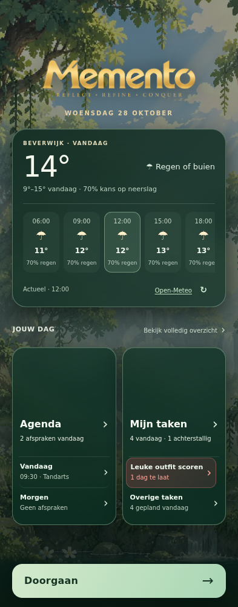
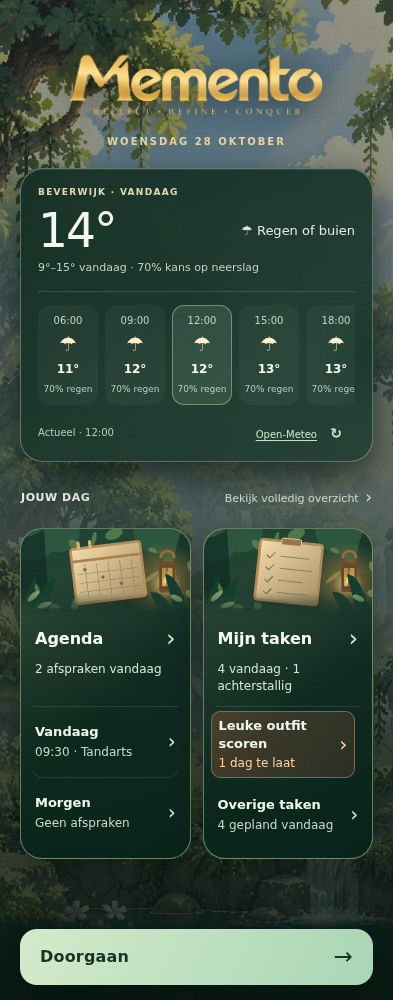

# Startscherm — Memento Design System, 29 oktober 2026

Basis: main 89dc6321eaa12d17572f6481ed880cf5286544cf.

Vraag: vernieuw het actieve startscherm volgens Memento Design System. De bestaande structuur en definitieve assets blijven leidend. De weerkaart blijft conform het template ongewijzigd.

## Wijziging

`assets/memento-start.css`: bosgroene gelaagde kaarten met subtiele gouden randlichtwerking, amberkleurige achterstallige status, grotere tekst (12–13 px in plaats van 10–11 px), minimaal 44 px hoge kaartkoppen, kleinere illustratievlakken en drukfeedback. Safe-area bovenaan, scrollruimte onderaan en een vaste Doorgaan-knop houden de inhoud bereikbaar. Bestaande reduced-motion ondersteuning blijft actief. Geen nieuwe CSS-overridebestanden.

`index.html` en `sw.js`: nieuwe stylesheetversie en offline cache v51. Geen wijzigingen in gegevensopslag, PIN-logica, weerlogica, financiële functies of illustraties.

## Uitgevoerde controles

- Chromium 153 via Playwright: bestaande startschermtest geslaagd op 360, 393 en 412 px breed. Controleert weerfixture, kaartverhoudingen, achterstallige preview, PIN instellen/vergrendelen/onjuiste en juiste invoer, herladen en JavaScript-fouten.
- Extra browsercontroles bij 640 en 800 px hoog: onderste kaartrij bereikbaar boven de vaste footer; kaartkoppen, kaartrijen, overzicht en Doorgaan minimaal 44 px hoog. Opgenomen in de test.
- `pin-disabled-regression.cjs`: geslaagd; ook syntaxiscontrole van 9 inline scripts. Cachecontrole volgt voortaan de stylesheet-URL in de HTML.
- `pin-forest-regression.cjs`: geslaagd.
- `service-worker-cache.cjs`: geslaagd.
- `git diff --check`: geslaagd.
- Voor/na visueel bekeken op 393 px breed. Screenshots gebruiken uitsluitend geïsoleerde testgegevens en gesimuleerd weer, geen echte gebruikersdata. SVG-MIME-type van de testserver gecorrigeerd zodat de illustraties daadwerkelijk zichtbaar worden.

## Grenzen

Geen fysieke Android-telefoon getest. De weer-API is in de tests gesimuleerd; actuele weersvoorspellingen zijn hiermee niet gevalideerd. Op korte schermen is scrollen nodig. De bestaande achterstallige preview is behouden; dit is geen implementatie van overige items uit de patchlijst.

